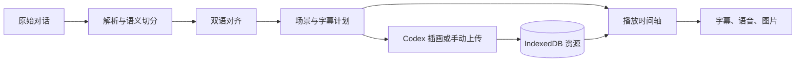

# 架构

主要制作流程在 Codex 中完成。Codex 根据对白生成插画并更新 GitHub Pages 的公开故事目录，播放器可直接加载和播放。浏览器配音、分镜和字幕编辑可在本地运行。

- `src/core` 处理解析、对齐、分镜和时间轴。React 不负责决定下一句。
- `src/providers` 为浏览器配音、图片代理、队列和可选语义对齐提供适配层。
- `src/storage` 管理 IndexedDB、媒体对象 URL 和 ZIP 编解码。项目数据与二进制资源分表保存。
- `src/components` 提供播放器、故事编辑器和设置。应用入口串行处理项目编辑，图片队列按场景 ID 和生成版本写回。
- `scripts` 包含可选本机代理与生产缓存生成器。GitHub Pages 只保存静态前端。

参考项目的学习流程使用本地资源覆盖、语音事件与浏览器回归测试。本项目使用独立的端口、IDB、LocalStorage 和生产缓存命名空间。
